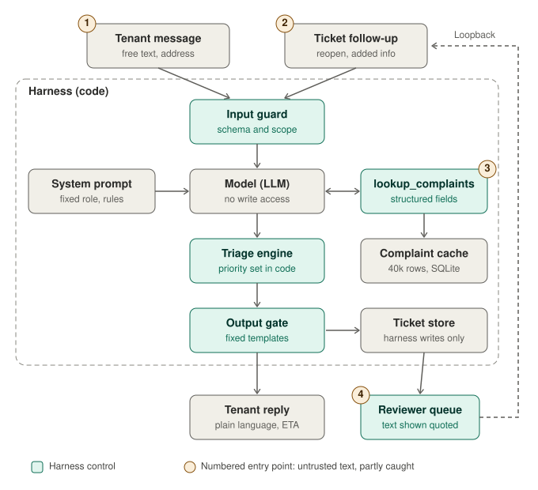
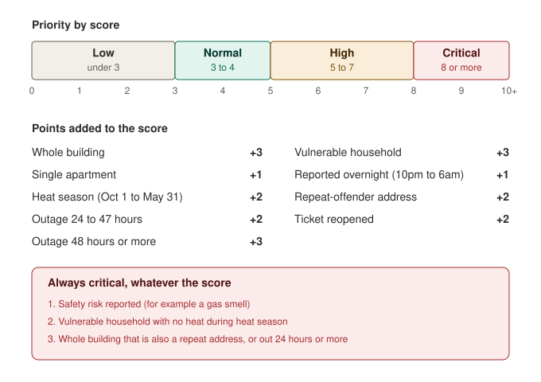

# 🔥 HeatWatch

**An AI triage agent for NYC heat and hot water complaints.**
HeatWatch takes a complaint, works out how urgent it is, tells the tenant what happens next, and lets them follow their ticket by number.

> 🧭 **Where we are:** the *decision engine* is built and tested. The chat agent, tickets and reviewer screens are the next phases.

---

## 😟 The problem

When the heat goes out in Washington Heights or Inwood, tenants report it to 311 and then wait with little idea what is happening. The public record shows:

- 📊 About **40,700 heat and hot water complaints** in the last two years in that one neighborhood (Manhattan Community Board 12)
- ⏱️ A typical complaint takes about **42 hours** to close, and 1 in 10 takes more than **84 hours**
- 🔁 About **35%** are closed as duplicates of another report for the same building
- 🚪 About **14%** are closed because the city could not get access to the apartment
- 🗓️ No complaint has a due date, and nothing in the record says how urgent it is

HeatWatch adds the missing pieces: an urgency ranking, a clear next step, and a ticket you can look up.

---

## 🧩 How it works

HeatWatch follows a simple loop:

| Step | What happens | Status |
|---|---|---|
| 👀 **Observe** | Collect the complaint and look up the address history | 🚧 history lookup built, chat not yet |
| 🧠 **Decide** | Score how urgent it is and check for duplicates | ✅ built |
| 📣 **Act** | Reply with a ticket number, a next step and an expected timeline | ⏳ not yet |
| 📝 **Feedback** | Save the ticket and let the tenant check progress | ⏳ not yet |
| 🔄 **Loopback** | Re-check tickets that are late, repeated or reopened | ⏳ not yet |

The main rule: **the AI talks, plain code decides.** The AI model will turn messy tenant text into a short form and write the reply wording. Ordinary code scores urgency, creates tickets and sends escalations, so a tricked model can't change who gets help first.

### 🏗️ The full stack



The numbered circles (1 to 4) mark where untrusted text could sneak in. The teal boxes are the checks that stand in the way. See [`docs/security-layer.md`](docs/security-layer.md) for the plain-English version.

---

## 🎯 How a complaint is scored

Every complaint gets points. The total decides its priority.



| Priority | Score | What it means |
|---|---|---|
| 🟢 Low | under 3 | Minor, usually an apartment outside heat season |
| 🔵 Normal | 3 to 4 | A single apartment, heat season, nothing else |
| 🟠 High | 5 to 7 | A whole building out, or an apartment with a long outage or repeat address |
| 🔴 Critical | 8 or more, or an override | Needs a person to look at it first |

### 🚨 Always critical

Some cases skip the score entirely:

1. ☣️ A **safety risk** is reported (for example a gas smell)
2. 👶 A **vulnerable household** has no heat during heat season
3. 🏢 A **whole building** is out and it is also a repeat-offender address, or has been out **24 hours or more**

### 🧮 Three quick examples

| Situation | Math | Result |
|---|---|---|
| Whole building, heat season, evening | 3 + 2 = 5 | 🟠 High |
| The same, at a repeat-offender address | override fires | 🔴 Critical |
| Apartment, heat season, outage of 30 hours | 1 + 2 + 2 = 5 | 🟠 High |

> ⚠️ **Honest note:** these weights are our best starting guess, not a proven formula. The public data has no field for outage length, vulnerability or safety, so those weights can't be tested yet. We'll re-check after the first real tickets.

---

## ✅ What is built so far

| Piece | What it does | Where |
|---|---|---|
| 📥 **Data loader** | Pulls the last two years of complaints from NYC Open Data into a local database | `app/loader.py` |
| 🗄️ **Database layout** | Tables for tickets, events, escalations, address history and priors | `app/schema.sql` |
| 🏠 **Address cleaner** | Makes "516 W 156th St." and "516 WEST 156 STREET" match | `app/address.py` |
| 📈 **Priors and address stats** | Typical close times, duplicate rates, and which addresses keep coming back (85 so far) | `app/priors.py` |
| ⚖️ **Scoring and overrides** | Turns a complaint into a priority with the reasons listed | `app/triage.py` |
| 👯 **Duplicate check** | Spots an open complaint already filed at the same address | `app/duplicates.py` |
| ⏳ **ETA lookup** | Quotes "usually resolved in about X hours, 9 in 10 within Y" | `app/eta.py` |
| 🧩 **One-call engine** | Takes a complaint and returns priority, reasons, duplicate, ETA and whether to escalate, all in one call | `app/engine.py` |
| 🎫 **Ticket store** | Creates tickets with hard-to-guess numbers, logs every step, and shows a safe public view | `app/tickets.py` |
| 💌 **Replies and output gate** | Builds the tenant reply from fixed templates and blocks promises or claims of filing | `app/replies.py` |
| 🔬 **Backtest** | Replays the scoring over past complaints to see how the bands behave | `app/backtest.py` |
| 🧪 **Tests** | 61 tests covering the loader, refresh job, schema, engine, tickets and replies | `tests/` |

### 🔍 What the backtest showed

| Priority | Share of complaints | Typical time to close |
|---|---|---|
| 🔴 Critical | about 32% | 35 hours |
| 🟠 High | about 50% | 44 hours |
| 🔵 Normal | about 18% | 48 hours |
| 🟢 Low | under 1% | 40 hours |

Two things to know:

- 🏚️ The bands describe **how bad it is for the tenant**, not how fast the city closes it. Critical cases close sooner largely because many are duplicates.
- 🔁 Most of the critical group comes from **85 repeat addresses** that account for about 40% of all complaints. The backtest counts repeats across the full two years, which overstates what would be known on the day.

---

## 🚧 What is not built yet

- 💬 The chat that collects a complaint (and Spanish support)
- 🖥️ A page or chat for ticket lookup and follow-ups (the data layer exists)
- 👩‍💼 The reviewer queue and escalation alerts
- 🔄 Automatic re-check of late and repeated tickets
- 🛡️ The four security requirements (see below)

### 🛡️ The four security requirements (planned)

1. 📋 The address lookup returns simple facts, never free text written by someone else
2. 🔒 The AI can't create or change tickets
3. 💬 Tenant text shown to reviewers is marked as a quote
4. 🙋 Claims nobody can verify ("gas smell", "infant at home") always go to a person

---

## 🚀 Try it yourself

You need **Python 3.10 or newer**. Nothing else to install.

```bash
# 1. Pull the last two years of complaints into a local database (about 10 seconds)
python3 -m app.loader

# 2. Build the address and prior statistics, then see how the bands behave
python3 -m app.backtest

# 3. Run the tests
python3 -m unittest discover -s tests
```

The database is saved to `data/heatwatch.db` and is not committed to git.

### 🔄 Keep the data fresh

```bash
python3 -m app.refresh
```

This pulls new complaints, drops anything older than two years, and rebuilds the address stats and priors. It is safe to run again, and if the city's site is down it leaves your existing data untouched and exits with an error. To run it every morning, add a line like this with `crontab -e` (adjust the folder):

```
0 5 * * * cd /path/to/HeatWatch && /usr/bin/python3 -m app.refresh >> data/refresh.log 2>&1
```

When it last ran, and any error, are stored in the database (`meta` table: `last_refresh`, `last_refresh_error`).

✔️ **Tests run automatically** on every pull request and on pushes to `main` (GitHub Actions, Python 3.10 and 3.13). The workflow is in `.github/workflows/tests.yml`.

---

## 📁 What's in this repo

```
HeatWatch/
├── app/                    the engine
│   ├── loader.py           pulls 311 data
│   ├── refresh.py          daily job: load, prune, rebuild priors
│   ├── address.py          cleans addresses
│   ├── priors.py           builds close-time stats and repeat flags
│   ├── triage.py           scoring and overrides
│   ├── duplicates.py       duplicate detection
│   ├── eta.py              expected timeline
│   ├── engine.py           one call: complaint in, full assessment out
│   ├── tickets.py          ticket store and public view
│   ├── replies.py          reply templates and output gate
│   └── backtest.py         checks the bands against history
├── tests/                  unit tests
├── docs/
│   ├── agent-architecture.svg   the stack diagram
│   ├── threshold-chart.svg      the scoring chart
│   └── security-layer.md        plain-English security addendum
├── BUILD_PLAN.md           phase-by-phase plan
├── INTERFACES.md           contracts between the engine and the agent/interface
└── HeatWatch PRD.docx      product requirements
```

---

## 🗺️ What's next

| Phase | Goal |
|---|---|
| 2️⃣ | Chat intake that collects the complaint |
| 3️⃣ | Tickets and replies |
| 4️⃣ | Ticket lookup and follow-ups |
| 5️⃣ | Reviewer queue and escalations |
| 6️⃣ | Loopback for late and repeat tickets |
| 7️⃣ | Privacy, load and pilot checks |

📚 More detail: [`BUILD_PLAN.md`](BUILD_PLAN.md) · [`docs/security-layer.md`](docs/security-layer.md)

---

## 📌 Good to know

- 🏙️ **Scope:** Manhattan Community Board 12 (Washington Heights and Inwood), heat and hot water complaints only.
- 🏛️ **HeatWatch doesn't file complaints with the city.** It triages and advises; HPD (the city housing agency) remains the official record.
- 🏘️ **Public housing (NYCHA)** is handled through a separate city process and is out of scope.
- 📡 **Data source:** [NYC Open Data, 311 Service Requests](https://data.cityofnewyork.us/resource/fbiz-gkhq.json)
